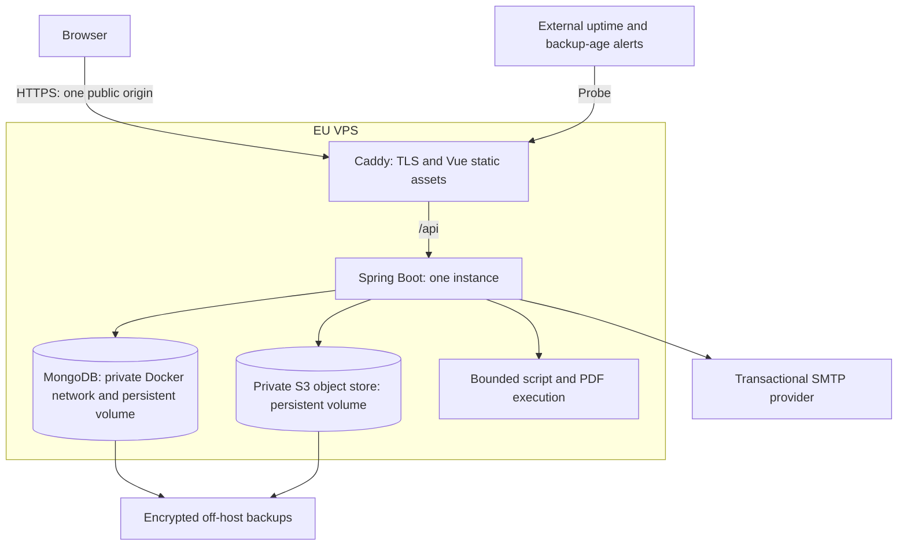

# Internet deployment plan for Peel Web

Prepared 17 November 2026; storage preference updated 18 November 2026. Confirmed launch scope: **hobby project, private beta / invited users, EU hosted, as cheap as practical, object storage on the same VPS, external email delivery**. User count and job volume are still unspecified. This is a repository review and deployment proposal, not a penetration test or a measured capacity assessment. No application behavior or infrastructure has been changed.

## 1. Recommended starting point

Start with **one EU VPS, Docker Compose, Caddy, one Spring Boot backend instance, MongoDB, a self-hosted private S3-compatible object store on that VPS, and an external transactional email provider**. Evaluate **SeaweedFS in `weed mini` mode** first; Versity is a simpler filesystem-backed candidate to compare. These are recommendations pending compatibility/resource tests, not an implemented storage selection. Build immutable frontend/backend images in CI and deploy those images. Keep backups outside the VPS and monitor availability from outside it.

For this cost-first invited beta, target **roughly €10–20/month before VAT**, including a small domain allowance, with **€20–30 as a fallback** if inexpensive VPS capacity is unavailable. These are planning targets, not purchase quotes. Choose an EU VPS from the available Hetzner/netcup/OVH-class offers; compare renewal prices, IPv4, setup charges and minimum contract terms. Favor **8 GB RAM when the premium is small**. A **4 GB server is an option only after a representative load test** with conservative memory limits and one heavy execution at a time; do not assume Java, MongoDB and PDF rendering fit safely without measurement. Build in CI, not on the VPS.

Use local MongoDB and local object storage with persistent volumes, keeping their ports on the private Compose network. The storage software has no separate hosting bill; it consumes the VPS disk, RAM and CPU. Include that overhead in the 4 GB versus 8 GB sizing test. Managed EU object storage remains an optional alternative or backup destination, rather than part of the required application stack.

Keep application data, object storage, backups and any exported telemetry in explicitly selected EU regions. Start by evaluating **Scaleway TEM Essential** for SMTP: its published allowance is 300 emails with no subscription and €0.25 per additional 1,000. Its service documentation identifies Paris as the hosting region. Validate current quotas, activation, delivery and processing terms. Avoid assuming a provider's European headquarters means every service/account is EU hosted. Email necessarily travels to recipients' chosen mail providers. [Scaleway email pricing](https://www.scaleway.com/en/pricing/managed-services/), [TEM data location](https://www.scaleway.com/en/docs/transactional-email/reference-content/data-privacy/).

One server is a deliberate single point of failure. It is suitable only if maintenance downtime and recovery from backups meet the launch requirements. Public signup additionally needs stronger execution isolation, quotas, and abuse controls before launch.



PEEL scripts run in separate JVMs with a configurable five-second default deadline. Direct runs, previews, and batch rows share two worker slots per backend by default. Each worker runs under the backend's OS identity. Review filesystem and network isolation before opening public signup.

### Minimum beta scope and deliberate deferrals

**Keep for launch:** server-enforced email allowlist/invitation gate, HTTPS/private service ports, current authorization and CSRF, execution/input limits, bounded job admission, interrupted-job failure/retry handling, upload stream fix, real persistent storage, tested off-host backups, basic health/logs/alerts, a clean reproducible build, and a repeatable deployment/rollback procedure.

**Defer:** Swarm/Kubernetes, a deployment UI, a separate worker VPS, Redis/shared sessions, automatic job resumption, a message broker, paid Atlas, paid error tracking, a full tracing stack, an always-on staging VPS, historical file browsing and sophisticated migration tooling. For a beta, explicit job retry, short deployment downtime, and re-login after restart are reasonable proposed tradeoffs, to document for invitees. Reliable execution limits and recoverable data remain necessary even for trusted users.

Use disposable/local staging with isolated data and SMTP before release. Persistent immutable job snapshots can follow the initial beta if reproducible historical output is not required yet; record application/Core versions now and clearly state that an explicit retry may use current project contents until snapshotting exists. Do not silently promise reproducibility.

## 2. What the repository already has, and what is missing

| Area | Evidence in the current checkout | Deployment consequence |
| --- | --- | --- |
| Authentication | Spring Security one-time email login, server sessions, CSRF, secure cookie defaults | Good foundation; preserve the same-origin design. |
| Authorization | Project checks in resource services, cross-project reference validation, project-owned print jobs | Keep these checks; require cross-account regression tests in CI. |
| File concurrency | `ProjectFile.version`, `expectedVersion`, atomic conditional update/delete, `409` conflicts | File revision numbers already exist. Do not replace them with a global app version. |
| Coordination | `ProjectAccessService` uses process-local locks | Deploy exactly one API instance initially. Rolling overlap can violate cross-resource invariants. |
| Login state | `InMemoryOneTimeTokenService` and in-memory rate-limit maps; servlet sessions are local | Restarts invalidate links and sessions and reset abuse counters. Multiple replicas cannot share this state. |
| Execution | `PeelExecutionService` terminates child JVMs at the script deadline | Script requests share a bounded number of workers. Language analysis and PDF layout still need their own budgets. |
| Print jobs | State is saved in MongoDB and startup marks interrupted jobs failed | Resolved inputs still live in memory. Historical snapshots and automatic resumption remain separate work. |
| Background work | A dedicated executor runs one print job at a time | When busy, return `503` and let the user start the same job again. Execution time and resource limits remain separate work. |
| Persistence | Development Compose has MongoDB/MinIO, `latest` images, development credentials, no explicit data volumes | Create a separate production Compose definition; do not deploy this file as-is. |
| Build | Backend uses unconditional `includeBuild("../../peel")` and an unversioned Peel dependency | A clean CI checkout depends on a sibling source checkout. Publish and pin Peel Core. |
| Dependencies | Spring Boot `4.0.6` with springdoc `2.8.5` | Resolve the documented major-version mismatch before relying on OpenAPI generation. |
| Operations | No tracked production Dockerfiles/deployment workflows or Actuator dependency found | Add packaging, CI, health endpoints, logs, backups and release procedures. |

Primary code references: [security](../peelserver/src/main/java/de/flogehring/peelserver/impl/auth/SecurityConfig.java), [email login](../peelserver/src/main/java/de/flogehring/peelserver/impl/auth/AuthLinkService.java), [project locks](../peelserver/src/main/java/de/flogehring/peelserver/impl/project/ProjectAccessService.java), [file writes](../peelserver/src/main/java/de/flogehring/peelserver/impl/files/ProjectFileService.java), [job start](../peelserver/src/main/java/de/flogehring/peelserver/impl/printjobs/PrintJobService.java), [job runner](../peelserver/src/main/java/de/flogehring/peelserver/impl/printjobs/PrintJobRunner.java), [storage](../peelserver/src/main/java/de/flogehring/peelserver/impl/filestorage/StorageService.java), [build](../peelserver/build.gradle.kts), and [development Compose](../peelserver/compose.yaml).

Springdoc documents Boot 4 support in its 3.x line. Upgrade to a supported combination and run the API contract tests; a successful Java compilation alone does not validate this integration. [Springdoc compatibility](https://springdoc.org/).

## 3. Application logic and versioning

### Keep four separate version concepts

| Version | Purpose | Recommendation |
| --- | --- | --- |
| Application release | Identify the deployed software | Release tag plus commit SHA and immutable image digest. Expose nonsecret build information internally. |
| Database schema revision | Identify the persisted structure/indexes the app understands | Establish schema revision 1 and a small deployment ledger before retaining production data. Reject unsupported schema/app combinations. |
| File revision | Prevent lost edits | Keep the existing per-file counter and acknowledged-version behavior. It is concurrency control, not retained history. |
| Execution provenance | Explain exactly how an output was produced | Persist the resolved inputs and software versions at job start. A version number without the old content cannot reproduce a result. |

**Yes, introduce logical database schema versioning, but keep it small.** A single ledger recording schema revision, applied change IDs, timestamp and application release is enough initially. No historical data migration or compatibility layer is needed for this pre-production codebase. Before the first actual production schema change, add an explicit reviewed migration step, backup/restore procedure, and compatibility decision. Introduce a migration tool only when the changes justify one.

Do not add `schemaVersion` to every collection by default. Per-document format versions are useful when independently versioned/imported content needs them; otherwise a database revision is simpler. Schema revision, MongoDB server version and MongoDB feature compatibility version are separate concerns.

For each production print-job execution, persist an immutable manifest containing:

- Resolved document structure, referenced script content, render configuration, and their IDs/revisions.
- CSV object key and a content checksum; prevent replacement after execution starts.
- Peel Core version, application/image version, and rendering environment information such as fonts and locale.
- Start/end timestamps, status, safe failure reason and output keys/checksums.

The current behavior resolves content **when execution starts**. Preserve that boundary when adding snapshots; changing it to job creation would be a product decision. Historical file browsing and a general revision-history system can wait. Exact byte-identical PDFs may need additional control over timestamps and rendering metadata.

### Required reliability changes

1. **Bound computation everywhere:** script runs, language analysis, previews, template evaluation and print jobs. Apply script/body size, AST depth, evaluation steps, recursion, trace/output bytes, PDF pages, CSV rows/columns and execution-time limits. Values need workload measurements and a product decision.
2. **Stop runaway script execution:** the backend kills the script JVM at the deadline and releases its slot after the process exits. Keep analysis and PDF layout budgets separate. Review script worker filesystem and network access before public signup.
3. **Recover interrupted print jobs:** the single backend now marks interrupted jobs failed at startup and runs one batch at a time. A user can create a new job to rerun a failed batch. Partial outputs remain private and are removed with the project. Consider earlier cleanup and same-job retry if needed. Durable queues and worker leases can follow if automatic recovery or multiple workers become necessary.
4. **Stream downloads where practical** instead of reading entire objects into API heap. CSV and PDF uploads now pass the actual content length to object storage. Keep verification of upload and download behavior in the storage compatibility tests.
5. **Control growth:** introduce agreed per-account/project storage and workload limits, retention/cleanup for CSV/PDF outputs and failed attempts, pagination for unbounded lists, and bounded deletion work. Retention of user documents is a product decision, not an implicit cleanup rule.
6. **Preserve invariants:** keep current file CAS updates. Before adding API replicas, replace process-local coordination for membership, archive/delete, reference updates and job starts with appropriate database conditions/transactions or another reviewed coordination design. Shared sessions alone do not make the app horizontally safe.

## 4. Is login/security okay?

**The design is reasonable for a small email-authenticated application, but the current checkout should not be treated as ready for unrestricted public signup.** This review does not prove the absence of vulnerabilities.

Already good:

- Accounts are created after successful token verification, with normalized emails and a unique index.
- Login tokens are single-use and expire after 15 minutes; existing sessions cannot silently switch accounts.
- CSRF is enabled and the API client sends tokens on mutations, including login. Session cookies default to `HttpOnly`, `Secure`, and `SameSite=Lax`; idle timeout is eight hours.
- Email links require an explicit confirmation POST, reducing accidental consumption by link scanners. The SPA removes the login token from the URL; referrer restrictions exist in both HTML and backend configuration.
- Resource authorization is enforced in backend services. Missing and inaccessible resources return `404`; document references cannot cross projects.
- Invitation tokens are random and stored as hashes, and acceptance checks the signed-in recipient.

Before any internet launch:

1. **Configure the trusted proxy boundary.** Only Caddy is public; the backend has no published public port. Replace incoming forwarded headers at the edge and configure backend handling to trust only that path. Test real client IPs and spoofed forwarding headers: otherwise the existing per-socket-IP email limit may apply to the entire site, or become bypassable.
2. **Require HTTPS and production configuration.** Fail startup on insecure cookie settings, HTTP public origin, missing secrets or the `dev` profile in production. Set HTTPS redirect, HSTS after validation, content-type protections and a tested CSP at the edge serving the SPA. Account for Monaco workers and PDF `blob:` previews; test report-only first.
3. **Extend abuse controls.** Rate-limit token requests and login attempts, invitations/resends, project creation, analysis, execution, uploads and downloads as appropriate. Add a total email sending budget and bounded rate-limit storage. Current per-address/per-IP request limits are useful but do not cover distributed abuse or invitation spam. CAPTCHA is an escalation option if observed abuse warrants it.
4. **Protect credentials in telemetry.** Do not log token query parameters, invitation URL tokens, cookies, CSRF headers, SMTP credentials, bindings, scripts, CSV contents or document bodies. The initial login URL reaches Caddy before Vue removes it, so redact/omit sensitive paths and queries there. Set no-store caching for authentication and private API responses.
5. **Audit execution and rendering boundaries.** Test malicious/large scripts and traces. Review Pebble template capabilities and HTML-to-PDF resource loading; explicitly deny local files and unapproved outbound URLs, including private/cloud metadata addresses. The review found an area requiring validation, not a demonstrated SSRF or template exploit.
6. **Restrict operational endpoints.** The security chain currently permits non-`/api` paths by default. Explicitly restrict Swagger/OpenAPI, future Actuator endpoints, error detail and admin consoles. Expose only a minimal health response needed by the deployment; keep detailed health/metrics private.
7. **Validate the release:** cross-account direct-ID access, foreign job downloads, revoked membership, archived projects, stale saves, CSRF, token replay/expiry, login session-ID rotation, logout invalidation, mail failures and proxy behavior. Scan dependencies/images/secrets and resolve findings based on reachability and severity.

For this invited beta, **enforce an actual server-side email allowlist or invitation policy**: the existing flow creates an account for any email that successfully signs in. A hidden login page or disabled signup button does not enforce private access. Define admission separately from project membership; avoid building a full signup-management system. Consider a VPN/access gateway only if every invitee can use it conveniently.

In-memory sessions and tokens are acceptable for a deliberately single-instance beta **if deploys signing everyone out and invalidating links are accepted**. For a smoother production experience, persist hashed login tokens with expiry and atomic single-use consumption; share sessions only when needed, using a supported Spring Session store. Never rely on TTL cleanup timing for token validity. Redis would add another service and is not needed just to launch one instance.

Email login inherits the security and availability of the mailbox/provider. Decide later whether sensitive ownership/account actions need fresh authentication, whether absolute session lifetime is required, and whether passkeys or external OIDC/MFA are necessary. Self-hosting a full identity platform is unnecessary for the initial scope.

## 5. Deployment alternatives

| Approach | Benefits | Costs/tradeoffs | Fit for Peel now |
| --- | --- | --- | --- |
| VPS + Docker Compose | Small, portable, predictable bill; matches existing services | You operate OS, runtime, backups and recovery; one-host downtime | **Recommended.** |
| VPS + Coolify or Dokploy | Deployment UI, domains, certificates and app lifecycle conveniences | Extra privileged control plane to maintain; backups remain your responsibility | Good if a UI saves you time. Keep it private/admin-only. |
| VPS + Podman Quadlet/systemd | Native service management; rootless options | More manual service/network packaging than Compose | Sensible if you already prefer Podman. |
| Plain JVM + static server + systemd | Few runtime layers | Host dependency and release management become your responsibility | Viable, but containers simplify reproducing Java/fonts/runtime. |
| Docker Swarm | Service scheduling, rolling updates and managed secrets | Multi-node operations and persistent state remain hard; one node gives no HA | Consider only when you need several nodes and prefer it operationally. |
| Self-managed k3s/Kubernetes | Kubernetes API, ecosystem and Flux/Argo CD | Control plane, ingress, storage, upgrades, security and backups to operate | Use for a Kubernetes requirement or learning objective, not initial cost savings. |
| AWS Lightsail / Azure VM | VPS-style deployment with hyperscaler services nearby | Usually higher all-in cost than budget EU VPS; still self-operated | Good if an existing cloud account/ecosystem matters. |
| AWS ECS/Fargate | Managed container scheduling; integrates with IAM, S3 and SES | More networking/billing complexity; database, ingress and logs are separate | Later if managed operations and scaling justify cost. |
| Azure Container Apps | Managed ingress/revisions and event-driven execution | Cold starts/state constraints, regional billing, separate DB/blob/logging | Good managed alternative after durable jobs and session decisions. |
| Managed app PaaS, e.g. Render/Railway | Fast service deployment and managed rollout UX | Per-service bills, storage/worker constraints and provider coupling | Request an actual workload quote if reduced operations is the priority. |
| Dedicated server | Stronger predictable CPU/storage at sustained load | Larger minimum commitment and hardware recovery responsibility | Revisit if PDF workloads saturate shared VPS CPU. |

“Local Kubernetes” needs clarification: k3s on rented servers can serve production; a cluster on a laptop/home network also needs reliable power, connectivity, ingress and physical operations. A single-node cluster is still a single failure domain. Multiple MongoDB replicas on the same VPS also do not provide host-failure protection.

Coolify and Dokploy document Compose support. Kubernetes GitOps is well served by Flux; neither requires moving the app into Kubernetes now. [Coolify](https://coolify.io/docs/core/docker-and-containers), [Dokploy](https://docs.dokploy.com/docs/core/docker-compose), [Flux](https://fluxcd.io/flux/get-started/).

## 6. Costs and sizing

Prices checked on 17 November 2026 where published; currencies are kept as listed, before tax unless specified. The ranges below are **planning estimates**, not provider quotes or capacity promises. Region, availability, backups, egress, retention and paid support change the bill. Free credits are excluded from recurring budgets.

Published reference points:

- Hetzner's June price table lists CX33 at **€8.49/month excluding IPv4/VAT**, and CPX32 at **€35.49**. The main Cloud page currently marks the cost-optimized offering unavailable, so do not budget on obtaining a CX33 immediately. [Published price adjustment](https://docs.hetzner.com/general/infrastructure-and-availability/price-adjustment/), [current availability](https://www.hetzner.com/cloud/).
- Hetzner Primary IPv4 is **€0.50/month**; server backups add **20% of server price**. Those snapshots supplement, rather than replace, application-consistent off-host backups. [IPv4 pricing](https://docs.hetzner.com/general/infrastructure-and-availability/ipv4-pricing/), [backup billing](https://docs.hetzner.com/cloud/billing/faq/).
- AWS Lightsail Linux/public-IPv4 bundles list **4 GB at $24/month** and **8 GB at $44/month**, before separate backup/object storage costs. [Lightsail pricing](https://aws.amazon.com/lightsail/pricing/).
- Azure Container Apps includes monthly grants of **180,000 vCPU-seconds, 360,000 GiB-seconds and 2 million requests**. That is not an always-running Java/MongoDB application's complete free hosting allowance. Active/idle billing and min/max replicas matter. [Container Apps pricing](https://azure.microsoft.com/en-us/pricing/details/container-apps/).

| Deployment scenario | Recurring planning allowance | Included assumptions |
| --- | --- | --- |
| **Confirmed beta: budget EU VPS, local MongoDB and object store** | **Target €10–20/month; €20–30 fallback** | Illustrative €6–12 compute/IP, €1–4 encrypted off-host backups, €1–2 domain allowance, free/very-low-volume external EU SMTP and basic monitoring. Object storage uses included VPS resources; extra disk/RAM can change the price. Actual ordering, tax, usage and availability determine the bill. |
| Budget EU VPS, local MongoDB, managed objects | **€25–50/month** if a low-cost 8 GB plan is available | Roughly €10–20 compute/IP/snapshot allowance, €5–10 object service, €3–8 off-host backup allowance, small domain allowance; email/monitoring initially free or low usage. |
| Same layout using a €35.49 VPS | **€50–80/month** | Higher compute bill, snapshots, object storage and independent backups; paid email can increase this. |
| VPS with Atlas Free | VPS scenario with possible RAM savings | Removes database administration but not application backups, object storage or limits. Do not subtract a dedicated DB server cost you were not paying. |
| VPS with Atlas Flex | VPS scenario **plus $8–30/month** | Prototype-sized managed database; verify feature/backup needs. |
| VPS with Atlas Dedicated | VPS scenario **plus from $56.94/month** | Published starting tier; verify chosen EU region and backup/transfer additions. |
| Lightsail 8 GB + local MongoDB | **$55–90/month** | $44 compute plus illustrative storage/backup/domain/email/monitoring allowance. |
| Azure Container Apps + Atlas + object storage | **$60–180/month planning envelope** | Small single backend with sustained availability, managed DB choice, objects, logs; calculate selected EU region and idle/active load. Can be lower with Free DB/low traffic or higher with workers. |
| AWS ECS/Fargate + Atlas + S3 | **$90–200/month planning envelope** | Small always-on backend, ingress, DB, storage, logs and transfer; NAT gateways and extra workers can materially increase this. |

The larger scenarios are alternatives, not a minimum spend for the confirmed beta. No managed object-storage subscription is planned. If external storage is later wanted, compare usage pricing against fixed minimum bundles. Provider VPS snapshots are optional if the tested off-host backup/rebuild procedure meets the recovery requirement; paying for both can wait. Evaluate [netcup's EU VPS offers](https://www.netcup.com/en/server/vps) alongside Hetzner rather than selecting an expensive replacement instance solely because the cheapest Hetzner family is unavailable.

The cloud envelopes are architectural estimates rather than calculated regional quotes. Reprice through the [AWS calculator](https://calculator.aws/) or [Azure calculator](https://azure.microsoft.com/en-us/pricing/calculator/) once CPU/RAM, traffic and required uptime are measured. Include engineering time when comparing self-hosting with managed services.

For a first load test, reserve memory for the OS, Docker, MongoDB, API heap/native memory and rendering peaks. Set explicit container memory/CPU limits and JVM sizing with headroom. Test simultaneous previews, a large CSV batch and active editors. Builds should run in CI, not consume the production VPS.

## 7. MongoDB, objects and backups

| Database option | Assessment |
| --- | --- |
| MongoDB on the app VPS | Recommended if minimizing recurring cost and accepting DB administration. Private network, persistent volume, app-specific credentials, pinned supported version, monitored disk/memory and tested off-host backups are mandatory. Host loss affects both app and database. |
| Separate MongoDB VPS | Resource/failure isolation, but another host to operate; a single DB host is still not HA. Useful when workload measurements justify separation. |
| Atlas Free | Reasonable for experiments or an explicitly limited beta. Published 512 MB storage/shared resources and feature restrictions need an upgrade trigger. Use a nearby supported EU region, TLS and the VPS IP allowlist. |
| Atlas Flex | Published $8–30 per 30 days and 5 GB storage. Intended for prototypes; assess limitations against workload requirements. |
| Atlas Dedicated | Better fit when database operations, production support/performance and stronger recovery options justify the expense. Starts at the published price above; region/options can differ. |

Atlas currently documents **optional daily Free-cluster snapshots retaining up to four snapshots**. Do not rely on the outdated blanket claim that Free has no backups. Enable and restore-test what the selected account/tier actually offers, and retain an independent export according to recovery needs. Free also lacks private endpoints and peering. [Atlas pricing](https://www.mongodb.com/pricing), [Flex costs](https://www.mongodb.com/docs/atlas/billing/atlas-flex-costs/), [Free limits](https://www.mongodb.com/docs/atlas/reference/free-shared-limitations/).

Standalone MongoDB is sufficient for existing single-document atomic file updates. A single-node replica set can provide features such as transactions/oplog-based backup workflows if needed, but adds operational requirements without host-level HA. Do not introduce transactions or a replica set solely for hypothetical future features.

**Object storage is a separate persistence requirement:** CSV uploads and generated PDFs are outside MongoDB. For this hobby project, run an open-source S3-compatible store on the same VPS, with a persistent volume and no public storage/admin ports. Browser access already goes through authorized backend downloads, so the S3 endpoint need not be internet-facing. Pre-create the bucket and narrow runtime permissions instead of granting unrestricted bucket administration.

The [MinIO community repository is archived](https://github.com/minio/minio). Evaluate these alternatives rather than basing a new deployment on an unmaintained server:

| Alternative | Fit for the same-VPS hobby deployment | Primary reference |
| --- | --- | --- |
| **SeaweedFS, `weed mini`** | First candidate: Apache-2.0 community software with S3 support and a documented single-process mode intended for one node. Keep optional interfaces private/disabled and use explicit credentials and persistent storage. | [Project and single-node mode](https://github.com/seaweedfs/seaweedfs) |
| **Versity S3 Gateway** | Apache-2.0 gateway exposing a local filesystem through S3. Attractive when a local directory plus an S3 interface is all that is needed; test filesystem/metadata and backup requirements. | [Project](https://github.com/versity/versitygw) |
| **Garage** | Lightweight S3 object store supporting single-node setup. Its quick-start explicitly warns that one-node deployment has no redundancy and is not its production recommendation. The documented topology tradeoff can suit a recoverable hobby setup; it is designed around replication across nodes. | [Single-node guide](https://garagehq.deuxfleurs.fr/documentation/quick-start/), [S3 coverage](https://garagehq.deuxfleurs.fr/documentation/reference-manual/s3-compatibility/) |
| **RustFS** | Apache-2.0 S3-compatible alternative supporting Docker and single-node/single-disk operation. Its container guide positions this unreplicated mode for testing and small workloads; evaluate the chosen release and recovery behavior before selection. | [Container guide](https://docs.rustfs.com/en/installation/container) |

Preserve the current S3 integration initially. The **MinIO Java SDK is a client library** and can be evaluated against another S3-compatible endpoint. Test bucket HEAD/existence, region/addressing, PUT/GET, multipart uploads, prefix listing, deletion, errors and restart/restore. Peel now passes the actual content length for CSV uploads and generated PDFs. Recreate test contents when trying the new service.

An even smaller deployment could store files directly in a backend-mounted directory, but that requires changing the storage implementation, safe key-to-path mapping, atomic writes and authorization-preserving downloads. Treat it as an alternative, not an additional storage backend to build. Keeping S3 avoids that rewrite and leaves a straightforward path to an external service later.

Backups must cover MongoDB, object data, release configuration and recovery keys:

- Agree targets before launch; an example beta target is **RPO 24 hours / RTO 4 hours**, subject to an actual restore drill. Important customer work may require a much smaller RPO.
- For simple initial dumps, quiesce writes/jobs so database references and object contents are consistent; otherwise design a consistent replica-set/object-versioning backup procedure. A live `mongodump` is not automatically a point-in-time snapshot across all collections.
- For the local object store, back up its required metadata/configuration as well as object data. Use its supported consistent backup method or stop storage writes/service during the copy. Do not assume copying a live data directory is safe. A backup on another directory/volume of the same VPS does not protect against losing that VPS.
- Encrypt backups and keep them off-host, preferably with independent account/provider access. Separate application and backup credentials; protect the recovery key outside the VPS.
- Define retention and immutability to match deletion/privacy policy. Object versioning protects against some mistakes but is not an independent backup.
- Restore to a clean environment and verify login, memberships, files and actual PDF/CSV downloads. Monitor backup completion, freshness, size and restore results. VPS snapshots alone do not establish database consistency.

## 8. Email delivery

Confirmed choice: **external email delivery** through the existing Spring `MailSender`; the object-storage decision does not change this. SMTP avoids a provider-specific API rewrite. Keep Mailpit strictly in development.

| Choice | Current reference | Recommendation |
| --- | --- | --- |
| **Scaleway TEM Essential** | Published 300-email allowance, no subscription; €0.25 per additional 1,000. | **First option to validate for the confirmed low-cost EU beta.** Select the EU service region, verify SMTP setup, activation/quota and processing terms, and test mailbox delivery. |
| Resend | Free: 3,000 emails/month, 100/day. Pro: $20/month for 50,000, with overage charges. | Easy beta option if the daily limit covers logins plus invitations and abuse headroom. |
| Amazon SES | Base outbound sending $0.10/1,000 emails, plus applicable data/add-ons. | Strong low-volume cost option if AWS setup and deliverability administration are acceptable. Request production access out of the sandbox. |
| Postmark / Brevo / Mailgun | Obtain a current quote for required region/retention/support. | Alternatives if delivery/support or data-processing requirements favor them. |

[Scaleway pricing](https://www.scaleway.com/en/pricing/managed-services/), [Resend pricing](https://resend.com/pricing), [SES pricing](https://aws.amazon.com/ses/pricing/), [SES production access](https://docs.aws.amazon.com/ses/latest/dg/request-production-access.html). Resend/SES remain alternatives; validate their data-processing/region arrangements before choosing them for an EU-hosted setup.

Setup checklist: dedicated sending subdomain, verified sender, SPF/DKIM, DMARC with monitored rollout, authenticated SMTP with required TLS, provider quotas/budget alerts, signed and replay-safe bounce/complaint webhooks, suppression handling and an external delivery check. Disable click/open tracking on authentication emails. Keep an actual monitored support/reply address; SMTP delivery acceptance does not prove inbox delivery.

Keep the existing synchronous delivery initially if its bounded timeouts and user-visible failures are acceptable. Introduce a durable mail outbox when delivery retries must survive restarts. Retries must preserve correct token validity/single-use semantics and avoid repeatedly emailing users after ambiguous delivery failures.

## 9. Observability beyond Grafana

Grafana is a visualization component; a working setup also needs collection, storage, instrumentation and alert delivery. Pick tools by the problem being solved.

| Need | Alternatives | Initial choice |
| --- | --- | --- |
| Availability/TLS/DNS checks | External hosted monitor; Uptime Kuma on a different machine | External monitor that can alert when the VPS is down. |
| Host/container health | Netdata, Checkmk, Zabbix; Prometheus-based collection | Lightweight host monitoring with CPU, RAM, disk, I/O, restarts and OOM alerts. |
| Application errors | Sentry; smaller compatible error trackers after evaluation | Hosted Sentry if its processing/retention terms fit. Self-hosting the full stack is extra operations. |
| Metrics, traces and logs | SigNoz, OpenObserve, Elastic Observability, Datadog, New Relic; Grafana with Prometheus/Loki/Tempo | Start with logs/metrics; add one backend for traces when needed. |
| Portable instrumentation | OpenTelemetry Java agent/SDK, Micrometer | Actuator/Micrometer health/metrics and structured JSON logs; optional OTel agent. |

Primary references: [Netdata](https://www.netdata.cloud/open-source/), [Checkmk](https://docs.checkmk.com/latest/en/), [Sentry Spring Boot](https://docs.sentry.io/platforms/java/guides/spring-boot/), [SigNoz OTel ingestion](https://signoz.io/docs/ingestion/self-hosted/overview/), [OpenTelemetry Java agent](https://opentelemetry.io/docs/zero-code/java/agent/). Other names are alternatives to evaluate, not recommendations to install together.

Instrument request latency/error rates, authentication/mail failures, rate limits, script/preview duration, job failures and queue age, MongoDB connection/latency, disk growth, object operations and backup age. Alert on stuck jobs, storage exhaustion and failed backups. Correlate request/job IDs in logs without placing high-cardinality user/job IDs in metric labels.

Ensure unexpected exceptions are captured server-side with correlation IDs: the current generic exception handler returns a safe message but does not itself log the exception. Restrict telemetry access, scrub sensitive payloads/URLs, rotate local logs, and cap retention and ingestion budgets. Do not host the only alerting system on the server it monitors.

For the confirmed beta, start with rotated local JSON logs, private health/metrics, host/disk checks and external availability/backup-age alerts. Use an external monitor with a suitable EU processing arrangement, or an existing EU machine if available; do not rent a second VPS solely for monitoring. Defer paid Sentry/SigNoz and full trace/log backends. Do not export user document content to a free telemetry service just to save hosting costs.

## 10. Secrets and host security

For one VPS, use a password manager as the human recovery source plus **root-owned secret files outside Git**, mounted read-only only into the services that require them. Spring Boot can read mounted configuration through `configtree:`; map filenames to actual property names and fail on missing required values. Do not assume every application supports a `_FILE` environment variable automatically.

Compose secrets are file mounts, **not an encrypted secrets vault**. Protect source-file permissions, backup access and disk security. Environment variables are acceptable where necessary but must not appear in logs, shell history, diagnostic exports or frontend Vite variables. Nothing shipped to the browser can be a secret. [Docker Compose secrets](https://docs.docker.com/compose/how-tos/use-secrets/), [Spring external configuration](https://docs.spring.io/spring-boot/reference/features/external-config.html).

Use separate credentials for MongoDB runtime/admin/backup, object runtime/backup, SMTP, registry pulls and CI deployment. Rotate tracked development credentials if any were reused elsewhere. For Git-stored encrypted configuration, SOPS with age is an option; hold the decryption key outside Git. AWS Secrets Manager/Azure Key Vault become attractive when deploying into their identity systems. Vault is unnecessary infrastructure for one small VPS.

Limit public ingress to HTTP/HTTPS; SSH only from an admin network/VPN or restricted addresses. Protect registrar, hosting, Git and email-provider accounts with MFA. Use nonroot application containers, drop unnecessary capabilities, restrict writable paths, set resource/PID limits, pin images and run as few privileged components as possible. Verify published Docker ports externally for both IPv4 and IPv6; host firewall assumptions alone are insufficient. Never mount the Docker socket into the application.

If OpenTofu/Terraform manages infrastructure, secure its state and plans too: sensitive values can be present despite redacted console output. [OpenTofu sensitive state](https://opentofu.org/docs/language/state/sensitive-data/).

## 11. Automatic deployment and GitOps

Recommended first workflow:

1. PR checks: backend unit/integration/auth/authorization tests using disposable MongoDB/object storage; frontend tests, type-check and production build; generated OpenAPI consistency; dependency/secret/container scans.
2. Release CI builds once using the Gradle wrapper, npm lockfile and pinned toolchains. Produce backend and frontend images, SBOM/provenance and release metadata; push to a registry by commit and digest. Do not use `latest` for production.
3. Deploy the exact digests to staging with separate database, objects, credentials and email safety controls. Exercise HTTPS, same-origin routing, deep links, login and a real PDF job. Keep production data out of staging.
4. Promote those digests through a reviewed production environment/release change. Validate config, schema compatibility, backups and sufficient disk, then run a serialized deployment.
5. Stop accepting jobs, drain or explicitly terminate them according to the implemented recovery policy, **stop the old API before the new API can write**, and start the new release. Health/readiness and a smoke check determine success. Retain the previous digests and a documented rollback command. A short maintenance window is simpler than unsafe multi-instance overlap.
6. Roll back application images only when compatible with the current schema/data. Otherwise use a forward fix or a deliberate data restore with acknowledged data-loss implications. A Git revert cannot undo database writes.

For Compose, CI over a narrowly scoped SSH deployment command is the smallest approach. It is automated CD, not necessarily GitOps. Pin SSH host keys, restrict deploy credentials, serialize releases, keep untrusted PR jobs away from production secrets, and avoid a general-purpose privileged self-hosted CI runner on the VPS. A deploy identity able to control Docker effectively controls the host.

If you specifically want **pull-based GitOps**, store environment manifests/image digests in Git and let a small root-owned host service reconcile an approved branch under a lock, with validation, audit logs and health/rollback handling. This removes inbound CI-to-server access but adds a reconciler to maintain. Coolify/Dokploy are a UI-oriented alternative. Use Flux/Argo CD if Kubernetes is chosen later. Do not auto-update arbitrary new registry tags without tests/promotion.

Use Ansible/cloud-init for repeatable host setup and OpenTofu for provider resources when useful; the deployment configuration can live in this repository initially. A second infrastructure repository is optional, not a prerequisite.

## 12. Integrating Peel Core correctly

The current integration is a **Gradle composite build using an adjacent checkout**, not a tracked Git submodule. Production CI should consume a versioned library artifact.

1. Add `maven-publish` to Peel Core, with source/Javadoc artifacts and a POM/module metadata that accurately declares runtime dependencies such as ANTLR. Release Core from its own tested tags.
2. Publish immutable versions, for example `de.flo-gehring:peel:0.1.0`, to Maven Central for a public library, or GitHub Packages/private Maven storage when access control is needed. Version shown here is illustrative. Do not overwrite released versions or deploy `SNAPSHOT` dependencies.
3. In Peel Web, add the artifact repository and an explicit Core version; make the sibling composite build an opt-in local-development override. Do not depend on `mavenLocal()` or a developer's filesystem in CI.
4. Add dependency verification/locking as appropriate and test a clean build without `../peel`. Publish and consume the real transitive runtime metadata; build success with a composite substitution does not prove the publication is correct.
5. Align toolchain/build support: Core currently requests Java 22 while the server requests Java 25. Decide a supported Core bytecode/runtime baseline, and ensure the publisher and server CI provision the required JDKs. The production server image needs a supported Java 25 runtime for the current backend.
6. Run Peel Web's language/rendering contract tests when updating Core, regenerate and synchronize the relevant root/frontend API definitions when contracts change, and record the Core version in job provenance. Automate update PRs rather than silently tracking Core main.

This retains normal library integration; a separate network service for Peel Core is unnecessary just to solve dependency packaging. Execution isolation is a separate decision. [Gradle Maven publishing](https://docs.gradle.org/current/userguide/publishing_maven.html).

## 13. Phased implementation backlog and launch gates

| Phase | Deliverables | Exit evidence |
| --- | --- | --- |
| 0 — Complete the launch contract | **Confirmed: invited beta, EU hosted, minimize cost.** Still decide users/jobs/CSV sizes, data sensitivity, RPO/RTO, acceptable downtime and output reproducibility. | Initial €10–20 target/€20–30 fallback repriced against an available offer; remaining operational tradeoffs recorded. |
| 1 — Make execution and data safe | Server-side beta admission; limits; verified bounded job execution; interrupted-job policy; upload/download fixes; release/Core version recording; schema revision policy; dependency compatibility; basic abuse controls. Full snapshots only if required for beta output guarantees. | Tests prove bounded execution, failed-job recovery, retry cleanup, authorization and concurrency invariants. |
| 2 — Package reproducibly | Published Core, clean builds, production Dockerfiles, `deploy/compose.yaml`, Caddy config, production config validation, health/metrics, secret-file mapping | Fresh machine builds without sibling checkout; images start with production dependencies and no dev services. |
| 3 — Provision and recover | EU VPS/network/firewall, DNS/TLS, private MongoDB, private S3, SMTP/domain authentication, off-host backups, external monitoring, patch schedule | Reboot test, external port scan, email delivery check and clean restore drill meeting chosen targets. |
| 4 — Release and rehearse | CI and disposable/local staging, generated contracts, digest promotion, serialized production deploy, rollback/runbooks, load/security checks | Deploy and restart during a job; recover correctly; rollback an app release; rehearse host loss and mail failure. |
| 5 — Invite users | Access policy, support channel, privacy/retention information, usage caps, backup/error/queue alerts | Named operator and support process; no unresolved launch blockers. |
| 6 — Grow only on evidence | Separate worker/DB, persistent sessions/tokens, stronger auth, HA or managed cloud when justified | Measurements or uptime/product requirements demonstrate the need. |

Before public signup, enforce killable isolated execution for scripts/previews/jobs, stricter per-account quotas, durable/restart-resistant abuse controls, reliable job admission/recovery and a documented security review. Isolation must cover all execution endpoints, not only batch printing. Stronger VM/microVM isolation or a separate worker host may be appropriate for adversarial workloads; containers alone are not a perfect security boundary.

Suggested production file layout, to create during implementation:

```text
deploy/
  compose.yaml
  Caddyfile
  env.example                 # names and safe examples only
  deploy.sh                   # serialized promotion and health checks
  backup.sh
  restore.md
  runbook.md                  # rollback, stuck jobs, mail/storage/host outages
.github/workflows/            # if GitHub is the chosen CI host
  ci.yml
  release.yml
  deploy.yml
```

Resolve the existing frontend Vue module-resolution issue if it still blocks type-checking. Verify each implementation change with the relevant tests and rehearse the deployment against production-like dependencies before inviting users.

## 14. Other deployment aspects to include

- **Ownership and response:** who receives alerts, patches the OS/runtime/dependencies, handles abuse reports and can recover accounts/infrastructure if the usual operator is unavailable.
- **Privacy and data lifecycle:** data classification, provider regions/subprocessors, retention/export/deletion, backups after deletion, and access to telemetry. Check applicable obligations before accepting customer data; hosting in the EU alone does not settle them.
- **Domain operations:** registrar MFA, renewal/payment monitoring, DNS recovery, TLS renewal and an independent support contact.
- **Supply chain and licenses:** Core/frontend/backend/container licenses, fonts used in PDFs, image/library maintenance, third-party notices, SBOM and vulnerability response cadence.
- **User experience during failure:** explicit maintenance/retry messages, stale edit conflicts, logout on deploy if sessions stay local, preservation of in-memory drafts, and preventing duplicate jobs after ambiguous HTTP failures. Current drafts remain session-only and can be lost when the browser closes.
- **Correctness of generated documents:** representative financial/calculation fixtures, locale/timezone/decimal policy, font coverage, large tables, and reproducible provenance. Reliability of calculations matters independently of uptime.
- **Capacity and money:** resource saturation tests, storage growth, retention effects, bandwidth and outbound mail limits, provider spending alerts, and a planned upgrade path when the cheapest tier is full/unavailable.
- **Disaster recovery beyond the disk:** loss of provider account, DNS, registry access or encryption keys; restore access should not depend entirely on the failed VPS.

Confirmed decisions: hobby project, private beta / invited users, EU hosted, minimize recurring cost, object storage on the same VPS and external email delivery. This plan recommends local MongoDB and a self-hosted S3 endpoint, with SeaweedFS mini as the first candidate to validate and Versity as a smaller filesystem-backed alternative. Decisions still needed: final storage implementation after testing, expected workload, data sensitivity, recovery/downtime targets and whether historical job reproducibility is a beta requirement. Exact server selection follows availability and a representative memory/rendering test.
