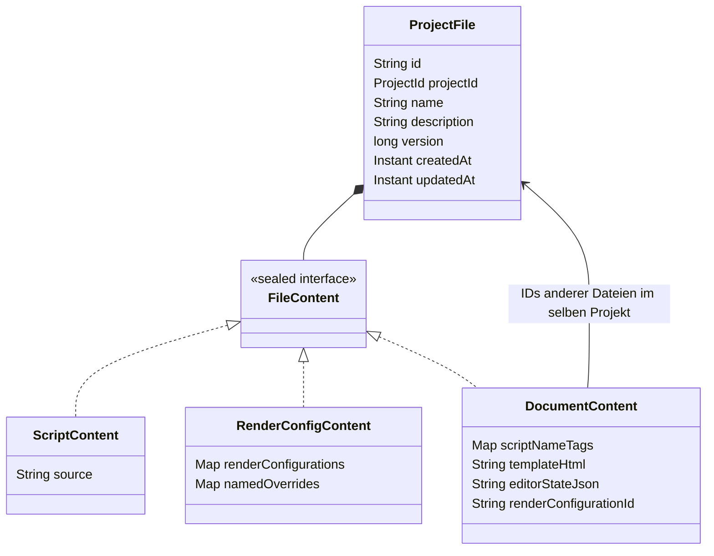

# Datenmodell

Die gemeinsame Dateiverwaltung ist in [FILE_MANAGEMENT.md](FILE_MANAGEMENT.md)
beschrieben. Skripte, Renderkonfigurationen und Dokumentvorlagen verwenden
`ProjectFile` und dieselbe MongoDB-Collection `project-files`.

Dateien werden für Ausführung und Rendering in fachliche Objekte aufgelöst.
Ein `Document` enthält die referenzierten `PeelScript`-Werte und eine
`ExpressionRenderConfiguration`. Diese aufgelösten Objekte besitzen keine eigene
CRUD-Verwaltung oder Collection. Ein Print-Job-Worker erhält den aufgelösten Stand
beim Start; eine persistente historische Dateiversion ist damit noch nicht eingeführt.

Print Jobs besitzen eine eigene unveränderliche Projektzuordnung. CSVs und PDFs
liegen weiterhin in MinIO. Benutzer, Projektmitgliedschaften, Einladungen und
Projektzustände bleiben eigenständige Datenmodelle.
